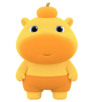
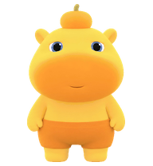
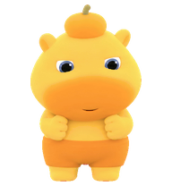
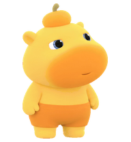

<div align="center">

# Codex Capybara Lulu Pet

**[简体中文](./README.md) · English**

A Capybara Lulu (水豚噜噜) desktop pet for Codex

</div>

## Animation Preview

<div align="center">

<table>
  <tr>
    <td align="center"><strong>Idle</strong><br /><br /><code>idle</code> · 6 frames</td>
    <td align="center"><strong>Waving</strong><br /><br /><code>waving</code> · 4 frames</td>
    <td align="center"><strong>Jumping</strong><br /><br /><code>jumping</code> · 5 frames</td>
  </tr>
  <tr>
    <td align="center"><strong>Move left</strong><br /><br /><code>running-left</code> · 8 frames</td>
    <td align="center"><strong>Working</strong><br /><br /><code>running</code> · 6 frames</td>
    <td align="center"><strong>Move right</strong><br /><br /><code>running-right</code> · 8 frames</td>
  </tr>
  <tr>
    <td align="center"><strong>Waiting for input</strong><br /><br /><code>waiting</code> · 6 frames</td>
    <td align="center"><strong>Ready for review</strong><br /><br /><code>review</code> · 6 frames</td>
    <td align="center"><strong>Failed or blocked</strong><br /><br /><code>failed</code> · 8 frames</td>
  </tr>
</table>

### Look Directions

<p align="center">
  <br />
  <code>look directions</code> · 16 directions
</p>

</div>

## Manual Installation

1. Clone the repository:

   ```bash
   git clone https://github.com/2Wren/lulu-codex-pet.git
   ```

2. Open the Codex App and go to **Settings → Pets → Custom pets → Open folder**.
3. Copy the `lulu` folder from the repository into the opened directory.
4. Return to the Codex App, click **Refresh**, and select Capybara Lulu.

### Command-line Installation

#### macOS / Linux

```bash
git clone https://github.com/2Wren/lulu-codex-pet.git
mkdir -p "${CODEX_HOME:-$HOME/.codex}/pets/lulu"
cp -R lulu-codex-pet/lulu/. "${CODEX_HOME:-$HOME/.codex}/pets/lulu/"
```

#### Windows PowerShell

```powershell
git clone https://github.com/2Wren/lulu-codex-pet.git
$codexHome = if ($env:CODEX_HOME) { $env:CODEX_HOME } else { Join-Path $HOME ".codex" }
$petDir = Join-Path $codexHome "pets\lulu"
New-Item -ItemType Directory -Force $petDir | Out-Null
Copy-Item ".\lulu-codex-pet\lulu\*" $petDir -Recurse -Force
```

## ChatGPT Web

> [!NOTE]
> Custom pets for the Codex desktop app and ChatGPT Web are managed separately; Lulu installed in the desktop app does not sync to the web.

For the web, download [`lulu/web-spritesheet.png`](./lulu/web-spritesheet.png) and upload it under **Settings → Personalization → Pet → Upload pet**. This is the `1536 × 1872` transparent PNG the web expects; the desktop `spritesheet.webp` (`1536 × 2288`) cannot be uploaded to the web directly.

You can also ask Codex to upload it for you:

> Please set Capybara Lulu as my ChatGPT Web pet: <https://github.com/2Wren/lulu-codex-pet>. Download `lulu/web-spritesheet.png` from the repository, then in my signed-in ChatGPT Web go to **Settings → Personalization → Pet → Upload pet**, upload and enable Lulu, and tell me the result.

## File Structure

```text
lulu/
├── pet.json
├── spritesheet.webp
├── web-spritesheet.png
└── previews/
    ├── idle.png
    └── …
```

- `pet.json`: pet metadata
- `spritesheet.webp`: Codex v2 animation spritesheet
- `web-spritesheet.png`: upload asset for ChatGPT Web
- `previews/`: README preview images; not needed at runtime

## Regenerating

Lulu's spritesheet is generated with the built-in Codex `$hatch-pet` skill, then validated and exported to web assets and previews by `scripts/release.py`.

## Copyright

The Capybara Lulu (水豚噜噜) character and related rights belong to its original creator / rights holder. This is an unofficial fan project for personal, non-commercial use only; if the rights holder objects, please get in touch and it will be removed.

The scripts and documentation in this repository are licensed under the [MIT License](LICENSE); the character artwork is not covered by the MIT License.
